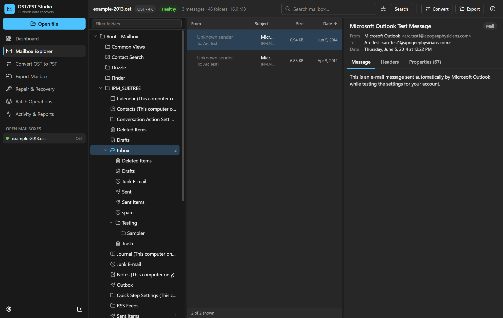

# OST/PST Studio

Open, browse, search, convert, repair and export Outlook **OST** and **PST** files on
Windows. No Outlook, no Exchange connection, no upload, no licence. MIT.

Built on the [pstfree](https://github.com/sp00nznet/pstfree) engine (MIT), with a new
desktop application (Tauri 2, React, TypeScript), a job system with real progress and
cancellation, validated output with allocation maps, independent verification through
libpff, and a technician command line.



## What it does

- **Opens** Unicode PST, Outlook 2013+ OST (4K pages, compressed blocks), pre-2013 OST
  and ANSI PST (Outlook 97-2002). "Password-protected" PSTs open without a password,
  because a PST password is a checksum, not a key.
- **Recovers** files whose index is gone: sweeps surviving B-tree pages, carves blocks
  with no index at all, and names what it could not confirm.
- **Browses** a three-pane explorer: folder tree, virtualised message list, sandboxed
  HTML preview, attachments with previews and hashes, every raw MAPI property.
- **Searches** across the mailbox by text in subject, sender, recipients, body and
  attachment names, with date, size, type, importance and attachment filters.
- **Converts** OST to a Unicode PST, and ANSI PST to Unicode, then reopens and
  validates the result and writes valid allocation maps so Outlook opens it directly.
- **Repairs** a damaged PST into a new, clean file. The original is never modified.
- **Exports** whole mailboxes, folders or selected messages as EML, MSG, MBOX, HTML,
  text, CSV, vCard, iCalendar or JSON, with attachment extraction.
- **Batches** many files with per-file progress and reports, bounded concurrency,
  cancellation and retry.
- **Reports** every job as JSON, HTML or text: counts, corruption, recovery actions,
  validation checks, and exactly how far Outlook compatibility was established.

## Install

Download the installer or portable build from the Releases page, or build it yourself
(below). Requirements: Windows 10/11 x64 and the WebView2 runtime (present on all
current Windows installations; the installer fetches it if missing).

## Build

```powershell
# Rust (stable, MSVC), Node 20+, and the Visual Studio C++ build tools.
npm install
.\scripts\fetch-fixtures.ps1   # public test fixtures, for the tests
cargo test --workspace
npm run tauri build            # installer + exe in src-tauri\target\release\bundle
cargo build --release -p ostpst-cli   # target\release\ostpst.exe
```

## Command line

```
ostpst info mailbox.ost
ostpst tree mailbox.ost
ostpst list mailbox.ost --folder Inbox --limit 50
ostpst search mailbox.ost invoice --body
ostpst convert mailbox.ost out.pst --report out-report.json
ostpst repair broken.pst fixed.pst --salvage
ostpst export mailbox.ost .\mail --format eml --folder Inbox
ostpst verify mailbox.pst
```

Add `--json` to any command for machine-readable output.

## Honest limits

- Outlook compatibility has been confirmed by opening converted and repaired fixtures in
  classic Outlook (they open directly, no SCANPST), but only on the two public fixtures.
  `scripts/outlook-check.ps1` is the manual check for your own files. See
  `docs/OUTLOOK_COMPATIBILITY.md`.
- Where FMap and FPMap pages recur in files over 125 MB and 2 GB is derived from the
  specification's figures, not observed in a file Outlook wrote.
- ANSI PST support has only been tested against a fixture written from the specification.
- Exporting a *selection* to a new PST is planned; convert and repair write the whole
  mailbox.

Full status: `docs/IMPLEMENTATION_STATUS.md`. Test results: `docs/TEST_RESULTS.md`.

## Privacy

Mailboxes are processed entirely on your computer; the application makes no network
connections and collects no telemetry. See `docs/PRIVACY_POLICY.md`.

## Licence

MIT. See `LICENSE`. The engine is derived from pstfree, copyright pstfree contributors,
MIT. Third-party notices are listed in the application's Settings page.
